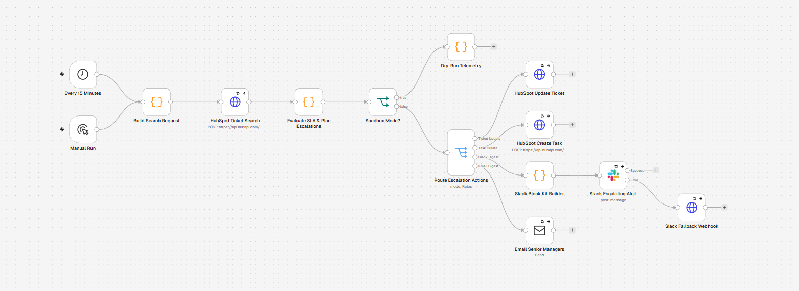
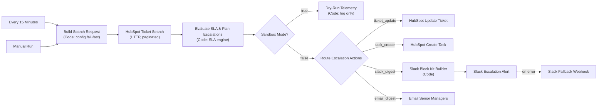

# n8n-hubspot-ticket-sla-escalation-router

An automated customer support workflow for [n8n](https://n8n.io) that monitors open HubSpot service tickets, measures elapsed **first-response** and **resolution** time against configurable SLA tiers, and escalates neglected tickets to team leads and senior managers through HubSpot tasks, Slack Block Kit alerts and email digests.


---

## Table of contents

1. [What it does](#what-it-does)
2. [Architecture](#architecture)
3. [SLA evaluation logic](#sla-evaluation-logic)
4. [Escalation routing](#escalation-routing)
5. [Repository layout](#repository-layout)
6. [Prerequisites](#prerequisites)
7. [Environment variables](#environment-variables)
8. [HubSpot setup](#hubspot-setup)
9. [Node configuration guide](#node-configuration-guide)
10. [Deployment](#deployment)
11. [Development and testing](#development-and-testing)
12. [Resilience and error handling](#resilience-and-error-handling)
13. [Security and privacy](#security-and-privacy)
14. [Troubleshooting](#troubleshooting)
15. [Disclaimer](#️-disclaimer--liability-limitation)
16. [License](#license)

---

## What it does

Every 15 minutes (or on demand) the workflow:

1. **Validates configuration** and stops immediately if anything is wrong (fail fast, before any API call).
2. **Searches HubSpot** for every open ticket (no `closed_date`), optionally restricted to one pipeline, with pagination.
3. **Maps each ticket to an SLA tier** (P1 / P2 / P3) from its HubSpot priority.
4. **Measures two SLA clocks** per ticket, on calendar hours or business hours:
   - *First response*: ticket creation → first agent reply (or now, if nobody has replied).
   - *Resolution*: ticket creation → now (open tickets only).
5. **Classifies** each clock as `OK`, `WARNING`, `BREACHED` or `CRITICAL`.
6. **Applies a cooldown policy** so managers are reminded, not spammed.
7. **Plans and routes actions**:
   - writes the SLA state back to the ticket (custom properties),
   - creates a HubSpot task for the owner (or a fallback owner when the ticket is unassigned),
   - posts one Slack Block Kit digest per run (with a webhook fallback),
   - emails a digest to support managers, adding senior managers when anything is critical.
8. **In `SANDBOX_MODE=true`** none of the above is executed. Every planned action is routed to a *Dry-Run Telemetry* node that logs a sanitized report.

---

## Architecture





### Single source of truth

All business logic lives in two dependency-free modules:

| Module | Responsibility |
| --- | --- |
| `src/config.js` | Parses and validates every environment variable. Collects *all* problems and throws one `ConfigError`. Treats `YOUR_…` / `your-…` values as unset. |
| `src/slaEngine.js` | Pure functions: date parsing, tier mapping, calendar and business-hour maths, classification, cooldown policy, HubSpot / Slack / email payload builders, sanitized telemetry and n8n item output. |

`scripts/build-workflow.js` inlines both modules into each n8n Code node and writes `workflow.json`. The code that runs in n8n is byte-for-byte the code covered by the tests, and CI fails if `workflow.json` drifts from `src/`.

### Item contract between nodes

The *Evaluate* node emits items with a `kind` field (used by the Switch) and a `sandbox` flag (used by the IF):

| `kind` | Payload | Consumed by |
| --- | --- | --- |
| `run_summary` | Sanitized telemetry, `status` (`OK`, `NO_INPUT`, `FETCH_ERROR`, `PARTIAL_FETCH_ERROR`, `PARTIAL_RATE_LIMITED`, `ENGINE_ERROR`) | Dry-Run Telemetry (sandbox); dropped by the Switch in live mode |
| `ticket_update` | `ticketId`, `body.properties` | HubSpot Update Ticket |
| `task_create` | `ticketId`, `body` (`properties` + `associations`) | HubSpot Create Task |
| `slack_digest` | `channel`, `escalations[]` | Slack Block Kit Builder → Slack |
| `email_digest` | `from`, `to[]`, `subject`, `text`, `html`, `ticketIds[]` | Email Senior Managers |

---

## SLA evaluation logic

### Tiers

| Tier | Default first response | Default resolution | Default HubSpot priorities |
| --- | --- | --- | --- |
| **P1** | 1 h | 8 h | `URGENT`, `HIGH` |
| **P2** | 4 h | 24 h | `MEDIUM` |
| **P3** | 8 h | 72 h | `LOW`, missing or unmapped (`SLA_DEFAULT_TIER`) |

The priority map (`SLA_PRIORITY_MAP`) and every target are configurable.

### Clocks

```
pctConsumed = elapsedHours / targetHours × 100
```

| Clock | Start | End | Notes |
| --- | --- | --- | --- |
| First response | `createdate` | first agent reply (`first_agent_reply_date`) or *now* | Once a reply exists the clock stops: `MET` or `MET_LATE`. It can no longer escalate. |
| Resolution | `createdate` | *now* | Only open tickets are fetched, so this clock always runs. |

With `SLA_BUSINESS_HOURS_ONLY=true`, only time inside `BUSINESS_HOURS_START`–`BUSINESS_HOURS_END` on `BUSINESS_DAYS` counts, in a fixed UTC offset (`BUSINESS_TZ_OFFSET_MINUTES`). A Friday 16:00 → Monday 10:00 gap on a 09–17 Mon–Fri desk is **2 business hours**, not 66 calendar hours.

### Classification

| Level | Status | Condition (defaults) |
| --- | --- | --- |
| 0 | `OK` | `pct < 80` |
| 1 | `WARNING` | `80 ≤ pct < 100` (`SLA_WARNING_THRESHOLD_PCT`) |
| 2 | `BREACHED` | `100 ≤ pct < 150` |
| 3 | `CRITICAL` | `pct ≥ 150` (`SLA_CRITICAL_THRESHOLD_PCT`) |

A ticket's level is the **worse** of its two clocks.

### Notification policy (de-duplication)

The router stores state on the ticket itself (`sla_escalation_level`, `sla_last_escalated_at`), so it is stateless between runs and safe to run on several schedules.

| Situation | Result | Reason code |
| --- | --- | --- |
| Level 0 | No notification (state reset if previously escalated) | `WITHIN_SLA` / `DEESCALATED` |
| No channel enabled for the level | No notification | `NO_CHANNEL_FOR_LEVEL` |
| Level increased since last run | Notify now | `LEVEL_INCREASED` |
| Escalated, but no timestamp recorded | Notify | `NO_PRIOR_ESCALATION_RECORD` |
| Same level, cooldown elapsed | Remind | `COOLDOWN_ELAPSED` |
| Same level, inside cooldown | Suppress | `COOLDOWN_ACTIVE` |

### Skipped tickets

Tickets that cannot be evaluated are skipped with a reason code instead of failing the run: `INVALID_TICKET`, `MISSING_ID`, `MISSING_CREATEDATE`, `TICKET_CLOSED`, `DUPLICATE`, `RUN_LIMIT_REACHED`.

---

## Escalation routing

| Level | Slack digest | HubSpot task | Email | Ticket properties |
| --- | --- | --- | --- | --- |
| WARNING (1) | ✅ | | | ✅ |
| BREACHED (2) | ✅ | ✅ (owner, or fallback owner) | | ✅ |
| CRITICAL (3) | ✅ + `SLACK_SENIOR_MENTION` | ✅ (priority HIGH) | ✅ `ESCALATION_EMAIL_TO` + `SENIOR_MANAGER_EMAILS` | ✅ |

Thresholds per channel are set with `ESCALATION_SLACK_MIN_LEVEL`, `ESCALATION_TASK_MIN_LEVEL` and `ESCALATION_EMAIL_MIN_LEVEL`. Each channel can be switched off with its `ENABLE_*` flag.

Unassigned tickets (no `hubspot_owner_id`) are flagged as **Unassigned** in Slack and email, and their task goes to `HUBSPOT_FALLBACK_OWNER_ID`. If no fallback is configured the task is created without an owner rather than failing.

---

## Repository layout

```
n8n-hubspot-ticket-sla-escalation-router/
├── .github/workflows/ci.yml     # Lint, build-consistency check, tests (Node 20 & 22)
├── scripts/build-workflow.js    # Compiles src/*.js into workflow.json
├── src/
│   ├── config.js                # Env parser + fail-fast validator
│   └── slaEngine.js             # SLA engine, payload builders, telemetry
├── tests/
│   ├── slaEngine.test.js        # Unit tests (node:test)
│   └── workflow.test.js         # Workflow harness: executes the Code nodes in a VM
├── .env.example                 # Configuration template (SANDBOX_MODE=true)
├── .gitignore
├── DISCLAIMER.md
├── LICENSE
├── package.json                 # Zero dependencies
├── README.md
└── workflow.json                # Importable n8n workflow (generated)
```

---

## Prerequisites

- **n8n** 1.x (self-hosted or cloud) with the Code node v2, HTTP Request v4.2, IF v2, Switch v3, Slack v2.2 and Send Email v2.1 nodes.
- **Node.js ≥ 20** for local tests and builds (no npm packages required).
- A **HubSpot private app** with access to tickets and tasks.
- A **Slack app** bot token (for the Slack node) and, optionally, an incoming webhook for fallback.
- An **SMTP account** for email digests.

---

## Environment variables

Copy `.env.example` to `.env` and load it into the n8n process. Code nodes read variables through `$env`, which requires `N8N_BLOCK_ENV_ACCESS_IN_NODE=false`. If env access is blocked, the router falls back to the safe defaults (including `SANDBOX_MODE=true`).

> Secrets never go in environment variables used by the Code nodes. HubSpot, Slack and SMTP credentials are selected from the n8n credential store. The only secret-bearing variable, `SLACK_FALLBACK_WEBHOOK_URL`, is read directly by the fallback HTTP node and never passes through the engine or its logs.

| Variable | Default | Description |
| --- | --- | --- |
| `SANDBOX_MODE` | `true` | `true` = dry run (log planned actions only). `false` = live. |
| `HUBSPOT_PORTAL_ID` | *(blank)* | Numeric portal ID, used only for ticket links. Placeholder `your-portal-id` is treated as unset. |
| `HUBSPOT_PIPELINE_ID` | *(blank)* | Restrict to one ticket pipeline. Blank = all. |
| `HUBSPOT_APP_BASE_URL` | `https://app.hubspot.com` | Base URL for links (EU portals may differ). |
| `HUBSPOT_FALLBACK_OWNER_ID` | *(blank)* | Owner for tasks on unassigned tickets. |
| `HUBSPOT_TASK_TICKET_ASSOCIATION_TYPE_ID` | `230` | HubSpot-defined task → ticket association type. |
| `HUBSPOT_FIRST_RESPONSE_PROPERTY` | `first_agent_reply_date` | Ticket property that marks the first agent reply. |
| `HUBSPOT_SEARCH_PAGE_SIZE` | `100` | Search page size (1–200). |
| `MAX_TICKETS_PER_RUN` | `500` | Hard cap on tickets evaluated per run. |
| `SLA_P{1,2,3}_FIRST_RESPONSE_HOURS` | `1` / `4` / `8` | First-response targets. |
| `SLA_P{1,2,3}_RESOLUTION_HOURS` | `8` / `24` / `72` | Resolution targets (must be ≥ first response). |
| `SLA_DEFAULT_TIER` | `P3` | Tier for missing or unmapped priorities. |
| `SLA_PRIORITY_MAP` | `URGENT:P1,HIGH:P1,MEDIUM:P2,LOW:P3` | HubSpot priority → tier. |
| `SLA_WARNING_THRESHOLD_PCT` | `80` | Warning threshold (< 100). |
| `SLA_CRITICAL_THRESHOLD_PCT` | `150` | Critical threshold (> 100). |
| `SLA_BUSINESS_HOURS_ONLY` | `false` | Count business hours only. |
| `BUSINESS_HOURS_START` / `_END` | `9` / `17` | Business window (0–24, decimals allowed). |
| `BUSINESS_DAYS` | `1,2,3,4,5` | Working weekdays (0 = Sunday). |
| `BUSINESS_TZ_OFFSET_MINUTES` | `0` | Fixed UTC offset of the support desk. |
| `ESCALATION_COOLDOWN_HOURS` | `4` | Minimum hours between reminders at the same level. |
| `ESCALATION_SLACK_MIN_LEVEL` | `1` | Lowest level posted to Slack. |
| `ESCALATION_TASK_MIN_LEVEL` | `2` | Lowest level that creates a HubSpot task. |
| `ESCALATION_EMAIL_MIN_LEVEL` | `3` | Lowest level that sends email. |
| `ESCALATION_TASK_DUE_HOURS` | `2` | Task due date offset. |
| `INCLUDE_TICKET_SUBJECT` | `true` | `false` keeps subjects out of Slack, email and tasks. |
| `ENABLE_SLACK` | `true` | Toggle Slack digests. |
| `SLACK_CHANNEL` | `#support-escalations` | Slack channel for digests. |
| `SLACK_SENIOR_MENTION` | *(blank)* | Mention added for critical tickets, e.g. `<!subteam^YOUR_GROUP_ID>`. |
| `SLACK_FALLBACK_WEBHOOK_URL` | placeholder | Incoming webhook used if the Slack node fails. |
| `ENABLE_EMAIL` | `true` | Toggle email digests. |
| `ESCALATION_EMAIL_FROM` | *(blank)* | Sender address (required when email is enabled in live mode). |
| `ESCALATION_EMAIL_TO` | *(blank)* | Comma-separated support manager addresses. |
| `SENIOR_MANAGER_EMAILS` | *(blank)* | Comma-separated, added only for critical digests. |
| `ENABLE_HUBSPOT_TASKS` | `true` | Toggle escalation tasks. |
| `ENABLE_TICKET_UPDATES` | `true` | Toggle SLA property write-back. |
| `PROP_ESCALATION_LEVEL` | `sla_escalation_level` | Custom property: current level (0–3). |
| `PROP_LAST_ESCALATED_AT` | `sla_last_escalated_at` | Custom property: last notification time. |
| `PROP_SLA_STATUS` | `sla_status` | Custom property: `NONE` / `WARNING` / `BREACHED` / `CRITICAL`. |

**Validation rules (fail fast).** Numbers must be in range; resolution ≥ first response for every tier; warning < 100 < critical; business start < end; valid weekday list; valid email syntax; snake_case property names. In live mode, Slack needs a channel and email needs a sender and at least one recipient. Every problem is reported together in a single `ConfigError`, and the run stops before HubSpot is called.

---

## HubSpot setup

### 1. Private app

Create a private app in HubSpot (*Settings → Integrations → Private Apps*) and grant:

- `tickets` (read and write tickets),
- the scope HubSpot lists for writing **tasks** in your portal's scope picker.

Store the token as an n8n **HubSpot App Token** credential. Never paste it into the workflow or `.env`.

### 2. Custom ticket properties

Create these on the **Ticket** object before going live (*Settings → Properties → Ticket properties*):

| Internal name | Field type | Purpose |
| --- | --- | --- |
| `sla_escalation_level` | Number | Current escalation level (0–3). |
| `sla_last_escalated_at` | Date and time | Last time a notification was sent. |
| `sla_status` | Single-line text (or dropdown: `NONE`, `WARNING`, `BREACHED`, `CRITICAL`) | Human-readable SLA state for views and reports. |

Without these, ticket updates fail (gracefully) and the cooldown cannot work, so every run re-notifies.

### 3. Confirm assumptions for your portal

- `first_agent_reply_date` is populated by HubSpot's conversations inbox. If your team replies through another channel, point `HUBSPOT_FIRST_RESPONSE_PROPERTY` at a property you maintain.
- Check that the task → ticket association type ID (`230` by default) matches HubSpot's current association reference.
- Check your portal's `hs_ticket_priority` values and adjust `SLA_PRIORITY_MAP`.

---

## Node configuration guide

| # | Node | Type | Configure after import |
| --- | --- | --- | --- |
| 1 | **Every 15 Minutes** | Schedule Trigger | Adjust interval. Keep it ≥ 5 min to stay well within HubSpot rate limits. |
| 2 | **Manual Run** | Manual Trigger | None. Use for sandbox testing. |
| 3 | **Build Search Request** | Code (generated) | None. Validates config and builds the search body. Do not edit in n8n. |
| 4 | **HubSpot Ticket Search** | HTTP Request | Select your HubSpot App Token credential. Pagination follows `paging.next.after`, max 10 pages (raise `maxRequests` for very large queues; HubSpot search caps at 10,000 results). |
| 5 | **Evaluate SLA & Plan Escalations** | Code (generated) | None. |
| 6 | **Sandbox Mode?** | IF | None. Routes on `$json.sandbox`. |
| 7 | **Dry-Run Telemetry** | Code (generated) | None. Output appears in the execution view and the n8n server log. |
| 8 | **Route Escalation Actions** | Switch | None. `run_summary` items match no rule and are dropped. |
| 9 | **HubSpot Update Ticket** | HTTP Request (PATCH) | Select HubSpot credential. Batched 5 per second. |
| 10 | **HubSpot Create Task** | HTTP Request (POST) | Select HubSpot credential. Batched 5 per second. |
| 11 | **Slack Block Kit Builder** | Code (generated) | None. |
| 12 | **Slack Escalation Alert** | Slack | Select your Slack credential and invite the bot to `SLACK_CHANNEL`. If your n8n version expects channel names without `#`, drop it from `SLACK_CHANNEL`. |
| 13 | **Slack Fallback Webhook** | HTTP Request | None. Uses `SLACK_FALLBACK_WEBHOOK_URL`. |
| 14 | **Email Senior Managers** | Send Email | Select your SMTP credential. |

Every outbound node retries up to 3 times with a 3-second wait, which covers HubSpot `429` and transient `5xx` responses.

---

## Deployment

1. **Clone and verify**
   ```bash
   git clone https://github.com/dhrobinsystems/n8n-hubspot-ticket-sla-escalation-router.git
   cd n8n-hubspot-ticket-sla-escalation-router
   npm run ci        # lint + build check + tests, no install needed
   ```
2. **Configure**: `cp .env.example .env`, edit values, keep `SANDBOX_MODE=true`. Load the file into n8n and set `N8N_BLOCK_ENV_ACCESS_IN_NODE=false`. Restart n8n.
3. **Prepare HubSpot**: create the private app and the three custom ticket properties ([HubSpot setup](#hubspot-setup)), ideally in a developer test account first.
4. **Import**: in n8n, *Workflows → Import from File → `workflow.json`*. Select credentials on the HubSpot, Slack and SMTP nodes.
5. **Dry run**: click *Manual Run → Execute Workflow*. Open **Dry-Run Telemetry** and review `planned`, `telemetry.escalations` and `lines`. Adjust thresholds until the planned actions match expectations.
6. **Go live in stages** (recommended): set `SANDBOX_MODE=false` with only `ENABLE_TICKET_UPDATES=true` for a day, then enable Slack, then tasks, then email. Restart n8n after env changes.
7. **Activate** the workflow and configure an n8n **Error Workflow** (*Workflow settings → Error workflow*) so fail-fast configuration errors alert someone.

### Updating the logic

```bash
# edit src/config.js or src/slaEngine.js
npm test
npm run build      # regenerates workflow.json
```
Re-import `workflow.json` (or paste the regenerated Code node contents) and re-select credentials if prompted.

---

## Development and testing

| Command | Purpose |
| --- | --- |
| `npm test` | Runs `tests/slaEngine.test.js` and `tests/workflow.test.js` with `node:test`. |
| `npm run test:coverage` | Same, with Node's built-in coverage report. |
| `npm run lint` | Syntax-checks every JS file and parses `workflow.json`. |
| `npm run build` | Regenerates `workflow.json` from `src/`. |
| `npm run build:check` | Fails if `workflow.json` is stale. |
| `npm run ci` | Lint + build check + tests (what CI runs). |

**What the tests cover**

- *Unit tests*: config parsing and fail-fast errors, placeholder handling, date parsing, tier mapping, threshold boundaries, business-hours maths (weekends, offsets), first-response stop (`MET` / `MET_LATE`), skip reasons, cooldown and level-change policy, missing owner fallback, Slack Block Kit limits and escaping, email HTML escaping and recipient rules, batch dedupe and run caps, telemetry redaction, n8n item output.
- *Workflow harness*: structural validation (node types, connections, reachability, Switch coverage, placeholder credentials, retry settings), build consistency, and **execution of every generated Code node** in an isolated VM with mocked `$input`, `$env` and `$execution`, including blocked env access, empty input, paginated input, rate-limit and auth errors, malformed tickets, the sandbox branch and the Slack builder.
- *Repository hygiene*: scans every file for tokens, live webhook URLs, private keys and non-placeholder email addresses.

---

## Resilience and error handling

| Failure | Behaviour |
| --- | --- |
| Invalid configuration | `ConfigError` lists every problem; run stops before any API call. |
| `$env` access blocked | Safe defaults are used; sandbox stays on. |
| HubSpot search error / `429` | HTTP node retries 3×. Remaining errors arrive as items; tickets already fetched are still processed and `run_summary.status` becomes `PARTIAL_RATE_LIMITED`, `PARTIAL_FETCH_ERROR` or `FETCH_ERROR`. |
| No open tickets / empty input | Single `run_summary` item, no actions. |
| Malformed ticket, missing dates, closed ticket, duplicate | Skipped with a reason code; other tickets continue. |
| Missing owner association | Flagged *Unassigned*; task goes to the fallback owner, or is created unowned. |
| Unexpected engine exception | Caught; `run_summary` with `status: ENGINE_ERROR` and a redacted message. |
| Slack node failure | Error output posts the same digest to the fallback webhook. |
| Email with no recipients | Email item is not emitted; a warning is added to `run_summary`. |
| HubSpot write rate limits | Update and task nodes are batched (5 requests / second) and retried. |

---

## Security and privacy

- **No secrets in code or JSON.** Credentials are n8n credential references with `REPLACE_WITH_…` placeholder IDs; CI rejects committed tokens, webhooks and real email addresses.
- **Sandbox by default.** `SANDBOX_MODE` defaults to `true`; a fresh install cannot write to HubSpot or message anyone.
- **Sanitized telemetry.** Run summaries and dry-run logs contain ticket IDs, tiers, levels and percentages only. Subjects are never logged; emails, Slack tokens, HubSpot tokens, bearer tokens and webhook URLs are redacted.
- **Data minimisation.** Set `INCLUDE_TICKET_SUBJECT=false` to keep ticket subjects out of Slack, email and tasks.
- **Escaping.** Ticket text is escaped for Slack mrkdwn and HTML email to prevent markup injection.
- **Least privilege.** Grant the HubSpot private app only the ticket and task scopes listed above.

---

## Troubleshooting

| Symptom | Likely cause |
| --- | --- |
| Run always lands in *Dry-Run Telemetry* | `SANDBOX_MODE` is still `true`, or `$env` access is blocked (`N8N_BLOCK_ENV_ACCESS_IN_NODE`). Check `configWarnings` on *Build Search Request*. |
| `Invalid SLA router configuration` | Read the listed problems; every invalid variable is named. |
| The same ticket is notified every run | Custom properties are missing, or *HubSpot Update Ticket* is failing. Check its output. |
| `401` / `403` from HubSpot | Credential not selected, or missing scopes on the private app. |
| Tasks created but not linked to tickets | Association type ID differs in your portal; set `HUBSPOT_TASK_TICKET_ASSOCIATION_TYPE_ID`. |
| No Slack message | Bot not invited to the channel, or channel format (`#name` vs `name`) differs in your n8n version. |
| SLA times look too high overnight | Enable `SLA_BUSINESS_HOURS_ONLY` and set the desk's UTC offset. |

---

## ⚠️ Disclaimer & Liability Limitation

Use at your own risk. The code, workflows, and scripts provided in this repository (`n8n-hubspot-ticket-sla-escalation-router`) are for educational and architectural demonstration purposes.

* **No Liability:** The author and dhRobin Systems assume no responsibility or liability for any direct, indirect, incidental, or consequential damages resulting from the use, misuse, or deployment of these scripts.
* **No Warranty:** All software, n8n JSON blueprints, and JavaScript modules are provided "AS IS" without warranty of any kind, express or implied, including but not limited to merchantability, fitness for a particular purpose, or non-infringement.
* **Production Testing Required:** Always test thoroughly in an isolated staging environment (for example a HubSpot developer test account or sandbox) with `SANDBOX_MODE=true` enabled before connecting live HubSpot credentials.
* **Third-Party APIs & Compliance:** Users are solely responsible for complying with the terms of service, rate limits, data privacy regulations (GDPR/CCPA), and security policies of HubSpot, Slack, and any connected services, including reviewing every automated ticket escalation and notification payload.

The full disclaimer is also available in [DISCLAIMER.md](https://github.com/dhrobinsystems/n8n-hubspot-ticket-sla-escalation-router/blob/main/DISCLAIMER.md).

## License

Released under the MIT License. Copyright (c) 2026 DH Robin (dhRobin Systems). See [LICENSE](https://github.com/dhrobinsystems/n8n-hubspot-ticket-sla-escalation-router/blob/main/LICENSE).
